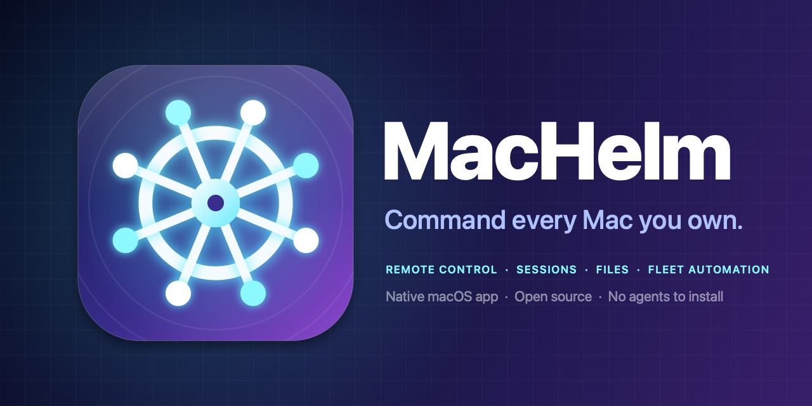

<p align="center"></p>

<p align="center">
<b>One native app to monitor, control and automate every Mac you own.</b><br>
No agents to install. No cloud. Built on the SSH and Screen Sharing that already ship with macOS.
</p>

## Features

| | |
|---|---|
| **Fleet dashboard** | Live CPU, memory, disk, battery and uptime for every Mac, grouped, with offline/online notifications. |
| **Remote control** | One click to full mouse-and-keyboard control through macOS Screen Sharing, plus live screenshots inside the app. |
| **Terminal** | Run commands with a persistent working directory and streamed output, or jump into Terminal.app / a persistent tmux session. |
| **Background sessions** | Start long-running jobs on a Mac that survive closing MacHelm; follow their live logs, stop or remove them. |
| **Files** | Browse, preview, upload (drag & drop), download, create and delete files on any Mac. |
| **Processes & apps** | Sort, filter and kill processes; list, launch, quit and force-quit apps; open URLs remotely. |
| **Controls** | Sleep, lock, restart, shut down, Wake-on-LAN, keep awake, volume, speech, notifications, typing text, clipboard, dark mode and more. |
| **Broadcast** | Run any command on many Macs at once and compare results. |
| **Scripts & automations** | Snippet library plus scheduled scripts on a group of Macs, with failure alerts. |
| **Command palette** | `⌘K` to jump anywhere. Menu-bar companion for quick actions. |
| **Bonjour discovery** | Finds Macs with Remote Login on your network. |

## Install

1. Download `MacHelm-x.y.z.dmg` from [Releases](../../releases), drag the app to *Applications*.
2. The build is ad-hoc signed, not notarized: right-click → **Open** the first time (or `xattr -dr com.apple.quarantine /Applications/MacHelm.app`).

Requires macOS 14+. Universal (Apple Silicon + Intel).

## Set up each Mac you want to manage

1. *System Settings → General → Sharing →* enable **Remote Login** (SSH) and, for screen control, **Screen Sharing**.
2. In MacHelm: **Add Mac** (or pick it from the discovered list), enter its address and user, and type its password once — MacHelm installs its own ed25519 key and never stores the password.
3. The **Connect** tab of every machine has copy-paste commands for Wake-on-LAN, always-on power settings and Remote Management.

Some actions need macOS privacy permissions on the *target* (Full Disk Access, Screen Recording, Accessibility for `sshd-keygen-wrapper`); the Connect tab explains which.

## How it works

Everything goes through `/usr/bin/ssh` with connection multiplexing and a dedicated key stored in `~/Library/Application Support/MacHelm`. "This Mac" is handled with a local shell. State (machines, scripts, activity) is plain JSON next to the key.

## Build from source

```bash
./scripts/build.sh      # -> build/MacHelm.app and build/MacHelm-<version>.dmg
```

Needs the Xcode Command Line Tools. If the macOS 27 SDK complains about a missing `SwiftUIMacros` plugin the script automatically uses the 26.x SDK.

## Security notes

Only manage Macs you own or are authorised to administer. Keys are passwordless by design — protect your account like you would any SSH key. Remote actions are logged under **Activity**.

## License

MIT
